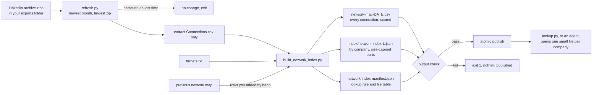

# linkedin-network-map

[](https://github.com/gkmr/linkedin-network-map/actions/workflows/tests.yml)   [](LICENSE)

Turns your LinkedIn connections export into a ranked, company-indexed map of warm paths into the companies you want to work at. It runs on your machine and needs nothing but Python 3.

## The problem

A referral gets a resume read; a cold application often does not. In my job search I kept applying cold to companies where I already knew someone, because LinkedIn search shows one company at a time and has no idea which companies matter to me. I built this to answer, for every target at once, "who do I know there, and who is the best person to ask", and to rebuild that answer by itself whenever a new export lands.

## How it works



`build_network_index.py` reads `Connections.csv` and a targets file, scores every connection, and writes a CSV map plus a JSON index keyed by company. `refresh.py` wraps it for a daily launchd job: it picks the newest archive, skips work when nothing changed, checks the build and publishes it so a reader never sees a half-written index.

### How paths are ranked

Each connection gets one score:

**score = 2 x company points + seniority points + 2 if shared employer + 1 if the export has their email**

| Company group (from your targets file) | points | Seniority (from the title) | points |
|---|---|---|---|
| tier1 | 5 | exec (chief, founder, president) | 5 |
| tier2 | 3 | vp (vp, vice president, head of) | 5 |
| search firm | 3 | recruiter | 4 |
| shared employer (you worked there) | 2 | director | 3 |
| tier3 | 1 | senior IC (senior, staff, principal, lead) | 2 |
| none | 0 | other | 1 |

Company points are doubled so the company dominates: a senior engineer at a tier-1 target (12) ranks above a VP at a tier-2 target (11). Recruiters score above directors because routing a referral is their job. In the example, Maya Okafor, VP at the tier-1 target Lumen Harbor with an email in the export, scores 2 x 5 + 5 + 1 = 16.

Matching a free-text Company field takes some care. Aliases match whole words, so "Lumen Harbor" does not match "Lumen Harborview Hotels". An `[exclude]` list blanks out different companies that contain an alias ("Orbitwell Capital"). The field is split on `|`, `,`, `(`, " - ", "now" and similar, and a former-word (ex, former, previously, retired) guards the aliases after it in the same segment: "Ex-Vellum Works, now Lumen Harbor" maps to Lumen Harbor, and "Formerly Lumen Harbor | Marigold Systems" maps to Marigold Systems.

The map lists rows at targets first, then by score. In the index, each company's people are listed best path first.

### The index

The index is one JSON object per first letter, `{company_key: [person, ...]}`, cut into parts of at most 44,000 bytes so an agent can open one company's file in a single tool call. `network-index-manifest.json` states the lookup rule in plain words plus a table of every part's key range, so a reader with only the manifest finds the right file. `lookup.py` follows that rule:

```
$ python3 lookup.py --index /tmp/lnm "Lumen Harbor"
Lumen Harbor: key "lumen harbor", file index/network-index-L1.json, 4 connections, best path first
   16  Maya Okafor - VP, Product  <maya.okafor@example.com>
   14  Ines Carvalho - Technical Recruiter
   13  Kofi Mensah - Director of Engineering  (company: Ex-Vellum Works, now Lumen Harbor)
   12  Theo Lindqvist - Senior Product Manager
```

## Quickstart

Python 3.8 or newer, nothing to install.

```bash
git clone https://github.com/gkmr/linkedin-network-map.git
cd linkedin-network-map

# build the invented example (a tiny size limit, so it shows split parts)
python3 build_network_index.py --connections examples/connections.example.csv \
  --targets examples/targets.example.txt --out /tmp/lnm --export-date 2026-11-01 --limit-bytes 600
python3 lookup.py --index /tmp/lnm "Lumen Harbor"

# run the tests
python3 -m unittest discover -s tests -v
```

The build prints one line per target (this is `examples/expected/summary.txt`):

```
T1     Lumen Harbor                4 paths  best: Maya Okafor, VP, Product (16)
T1     Orbitwell                   2 paths  best: Hana Sato, Chief Product Officer (16)
T2     Kestrel Data                3 paths  best: Omar Haddad, Head of Platform (11)
...
30 connections kept of 33 rows (1 hidden, 2 duplicates); 20 at targets; 16 index files
```

With your own data:

1. Request your data archive from LinkedIn (Settings, Data privacy, "Get a copy of your data"). Save each zip in an exports folder, optionally under a `YYYY-MM` subfolder.
2. Copy `examples/targets.example.txt` to your output folder as `targets.txt` and list your companies.
3. Run it once:
   ```bash
   LINKEDIN_MAP_EXPORTS_DIR="$HOME/LinkedIn exports" LINKEDIN_MAP_OUT_DIR="$HOME/network-map" \
     python3 -I refresh.py
   ```
4. Schedule it daily (macOS):
   ```bash
   mkdir -p "$HOME/.local/state/linkedin-network-map"
   sed -e "s|__REPO_DIR__|$PWD|g" -e "s|__EXPORTS_DIR__|$HOME/LinkedIn exports|g" \
       -e "s|__OUT_DIR__|$HOME/network-map|g" -e "s|__STATE_DIR__|$HOME/.local/state/linkedin-network-map|g" \
       launchd/local.linkedin-network-map.plist.template > ~/Library/LaunchAgents/local.linkedin-network-map.plist
   launchctl bootstrap gui/$(id -u) ~/Library/LaunchAgents/local.linkedin-network-map.plist
   launchctl kickstart gui/$(id -u)/local.linkedin-network-map   # run now; see refresh.log in the state dir
   ```
   The job runs `refresh.sh`, which starts python as a child of bash. So the job inherits the folder access you have already granted to bash. If `refresh.log` shows "Operation not permitted", grant access to the exports folder in System Settings, Privacy & Security, or move the exports somewhere the job can read.

## Privacy

- The tool runs locally and makes no network calls. Your export never leaves the machine: the zip is copied to a local temp folder, read, and the copy is deleted.
- Only `Connections.csv` is extracted. Messages, invitations and the rest of the archive are never read.
- Phone-shaped strings (9 or more digits) in names, titles and companies become `[number]`, and an email whose local part is a phone number is dropped. The output check refuses to publish if anything phone-shaped is left.
- Output goes only where you point `LINKEDIN_MAP_OUT_DIR`. If that folder syncs to a cloud drive, that is your choice, not the tool's.
- Every person and company in `examples/` is invented. `.gitignore` keeps zips, `Connections.csv`, maps and `targets.txt` out of git.

## How it is verified

`python3 -m unittest discover -s tests -v` runs 27 tests, stdlib only, no network, all in temp folders.

- **Expected output, byte for byte.** The example build must match every file in `examples/expected/` (16 index parts, the map, the manifest) and the CLI summary. The output has no timestamps, so any change in scoring, sorting or splitting shows up as a diff.
- **Known results on the invented data.** 33 rows: 1 hidden row dropped, 1 duplicate by URL (different case and a trailing slash), 1 by name and company, 30 kept, 20 at targets. Exact scores for the top 5. The traps behave: the word-boundary miss, both excludes, the former guards, the alias, the redacted title and the dropped phone-number email.
- **Index rules.** Keys sorted and inside their letter, parts under the limit unless a single company is bigger, ranges not overlapping, index rows equal map rows, nothing phone-shaped in any file. `lookup.py` finds the right part, including a company in the second part of a split letter.
- **Refresh end to end.** Publish, then "no change", then `--force` through `refresh.sh` with a stale part moved to `_superseded/`. A bigger zip in the same month triggers a rebuild, an empty newest month falls back, a missing targets file fails without publishing, a held lock exits "busy". Zip entries with `../`, an absolute path or a symlink are skipped, and only `Connections.csv` is extracted.
- **launchd template.** Renders to a valid plist with `plistlib`.

At run time `refresh.py` repeats the output check on every build before it publishes, so a bad build fails loudly instead of replacing a good index.

## Design decisions and tradeoffs

- **A score you can recompute by hand.** Every number in the map comes from the table above. The weights are my judgment, not learned, and there is no notion of how well you know someone.
- **Tier priority beats position in the text.** A tier-1 name anywhere in the Company field wins, so "Kestrel Data (advisor to Lumen Harbor)" files under Lumen Harbor. I accept a few false positives at my top targets over missing a path: a wrong row costs a glance, a missed path costs an introduction.
- **Small parts plus a lookup rule, not one big file.** An agent reads the manifest, then one file of at most 44 KB, instead of the whole network. The cost is exact-key lookup: "Kestrel" does not find "kestrel data" (the CLI suggests nearby keys).
- **Target rows filed under the target's name.** Everyone who maps to a target is found in one lookup, whatever their Company text says. Other connections stay under their own company text.
- **Publish atomically, never delete.** Files are staged under temp names and swapped in with `os.replace`; the archive manifest goes last, so a failed run just rebuilds next time. Stale parts are moved, not removed.
- **Extract one file to a fixed name.** The archive never chooses a path on disk, which removes the zip-slip class of bugs instead of filtering for it.

## Limitations

- First-degree connections only; the export has no second-degree network.
- The export only has each person's current company. "Shared employer" means they work now at a company you worked at, and "ex-Vellum" does not earn the bonus even though it may mark a former colleague.
- No recency or relationship strength. My private version also read message history for that; this version leaves it out.
- Seniority keywords are English and simple: "Account Executive" is "other", which is right, but unusual titles may land there too.
- LinkedIn hides some connections in the export (only the date is filled); those rows are dropped.
- The scheduler part is macOS (launchd). The scripts need a POSIX system for the lock (`fcntl`).

## Layout

```
linkedin-network-map/
├── build_network_index.py      score, index, split, check (library and CLI)
├── refresh.py                  newest archive -> build -> check -> atomic publish
├── refresh.sh                  launchd wrapper
├── lookup.py                   follow the manifest's lookup rule for one company
├── launchd/
│   └── local.linkedin-network-map.plist.template
├── examples/
│   ├── connections.example.csv 30 invented people, LinkedIn export columns
│   ├── targets.example.txt     invented target companies
│   └── expected/               the build output for the example, checked byte for byte
├── tests/
│   ├── test_build.py
│   ├── test_refresh.py
│   └── helpers.py
├── CHANGELOG.md
└── LICENSE
```
